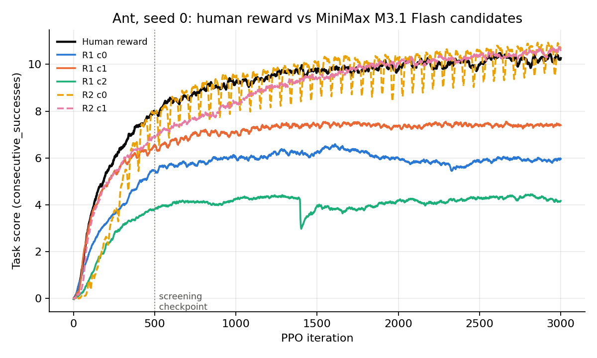
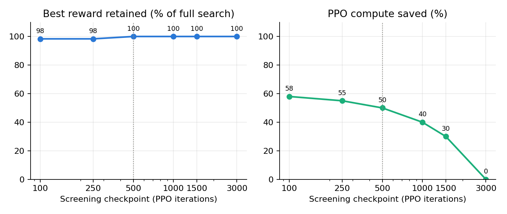

# Mini-Eureka on Ant with early screening: results

Isaac Gym **Ant**, PPO (upstream `AntPPO`, 4,096 envs, 3,000 iterations, seed 0). Rewards are written by
**MiniMax M3.1 Flash** (temperature 1.0) with Eureka's upstream prompts, code extraction, feedback and selection logic.
"Score" is the environment's own forward-progress metric (`consecutive_successes`); a run's score is its **peak** over
training, as in upstream Eureka. It has no fixed scale and is only comparable within this task.

## Summary

- The human reward scores **10.48** (seed 1: 10.33).
- Round 1 (3 independent samples) scored 6.59, 7.55 and 4.46. Round 2 (2 samples, written after seeing the best Round-1
  candidate's training feedback) scored **10.93** and **10.75**. The feedback step took the best from 72% to ~104% of the
  human score. With one seed, that is "matches the human reward", not "beats it" (see Limitations).
- Retrospective early screening at 500 of 3,000 iterations **saved 50% of the PPO compute (7,500 of 15,000
  iterations) and kept 100% of the best reward**, picking the full-training winner in both rounds. Screening at 100 or
  250 iterations picked the wrong Round-2 candidate (still 98% retained).
- On a small extra pool of first-round samples, checkpoint screening at 250-500 iterations kept 96-100% of the best
  score; asking the LLM to rank rewards before any training did not work (it ranked the best sample last).

## 1. Human reward vs MiniMax candidates

| Run | Peak score | Final score | Peak at iter | Score at 500 |
| --- | ---: | ---: | ---: | ---: |
| Human reward (seed 0) | 10.48 | 10.27 | 2628 | 7.93 |
| Human reward (seed 1) | 10.33 | 9.80 | 2569 | – |
| Round 1, cand 0 | 6.59 | 5.96 | 1611 | 5.45 |
| Round 1, cand 1 | 7.55 | 7.40 | 2292 | 6.56 |
| Round 1, cand 2 | 4.46 | 4.17 | 2816 | 3.81 |
| Round 2, cand 0 | **10.93** | 10.75 | 2858 | 7.91 |
| Round 2, cand 1 | 10.75 | 10.57 | 2990 | 6.95 |

Figure 1. Round-1 candidates plateau at 4-7.5. Both Round-2 candidates climb to the human curve. Round-2 cand 0 starts
slowly, then oscillates by about 1 point from iteration ~500 on; its peak (10.93) is a high point of that oscillation,
while its final value (10.75) is closer to the human final (10.27) than the peak suggests.

## 2. Search progression

- **Round 1** gets only the task description and environment code; three independent samples.
- **Round 2** is the upstream reflection prompt built from the best Round-1 candidate (cand 1): its reward code plus
  per-component statistics over training. Two samples.
- The best score moved 7.55 -> 10.93. Round 2 trained roughly as well as the human reward, and both Round-2 samples beat
  every Round-1 sample.
- Cost: one PPO run is 3,000 iterations = 196,608,000 environment steps (704 s alone on an A100; ~1,750 s when 3-4 runs
  share one GPU). Each LLM sample took 4-9 minutes and ~8.5k completion tokens on the hosted endpoint.

## 3. Early-screening simulation (Experiment C)

Rule: within each round, rank candidates by their best score up to a checkpoint, "reject" all but the top one, and
count only the iterations actually run. Compare with the full 3,000-iteration winner. The 500-iteration checkpoint was
fixed in advance; the others are exploratory.

| Checkpoint | Compute saved | Best reward retained | Round 1 pick correct | Round 2 pick correct |
| ---: | ---: | ---: | :-: | :-: |
| 100 | 58% | 98.3% | yes | no |
| 250 | 55% | 98.3% | yes | no |
| **500 (primary)** | **50%** | **100%** | yes | yes |
| 1000 | 40% | 100% | yes | yes |
| 1500 | 30% | 100% | yes | yes |
| 3000 | 0% | 100% | yes | yes |

Full search = 15,000 iterations (983,040,000 env steps); screening at 500 = 7,500 iterations (491,520,000 steps).
At 500 iterations Round-2 cand 0 led cand 1 by about 1.0 point (8.00 vs 6.96 best-through-500) and Round-1 cand 1 led by
1.1 (6.58 vs 5.48).

Figure 2. Left: best reward kept versus the full search. Right: compute saved. Dotted line = primary checkpoint.

**Caveat on Round 2.** Round 2 was generated using feedback from the *fully trained* Round-1 winner. In a real
screened search that feedback would come from a candidate trained only to the checkpoint, so this simulation does not
show that the screened search would have followed the same trajectory.

## 4. Extra first-round samples (exploratory)

To test the rules on more candidates I trained 6 additional first-round samples (the pool generation timed out before
reaching its target of 13), giving a pool of 9 with the three Round-1 candidates. Pool scores: 10.73 (cand 3), 9.41, 9.25,
6.95, 5.28, 0.01 (cand 5 collapsed). Every rule is evaluated by drawing sub-pools and checking what it keeps.

| Rule | 4-candidate sub-pools (126): best kept / true winner kept / compute saved | Full pool of 9: best kept / winner kept / saved |
| --- | :-: | :-: |
| Checkpoint 100, keep 1 | 87% / 33% / 72% | 70% / no / 86% |
| Checkpoint 250, keep 1 | 93% / 61% / 69% | 100% / yes / 81% |
| Checkpoint 500, keep 1 | 97% / 72% / 62% | 100% / yes / 74% |
| Checkpoint 500, keep 2 | 99% / 87% / 42% | 100% / yes / 65% |
| Successive halving 250 -> 1000 | 93% / 61% / 69% | 100% / yes / 79% |
| LLM ranks first, train top 1/4 | 56% / 5% / 75% | 65% / no / 78% |
| LLM ranks first, train top 1/2 | 83% / 31% / 50% | 88% / no / 56% |
| Zero-training probe, train top 1/4 | 70% / 17% / 75% | 65% / no / 78% |
| Zero-training probe, train top 1/2 | 88% / 50% / 50% | 100% / yes / 56% |
| Train one at random | 69% / 25% / 75% | 62% / 11% / 89% |

Reading it: waiting 250-500 iterations before judging is clearly better than random. Judging at 100 iterations is not
reliable. The LLM's blind ranking was no better than random and put the best candidate (cand 3) last of 9. The probe
(scoring each reward on scripted and sine-wave gaits in one simulation, no PPO) was weak at the top quarter, but its top
half kept the winner on the full pool. The sub-pools overlap, so they are not independent samples, and the full pool is a
single draw. See `results/exp_d_pool_minimax/fig_screening_rules.png` and `analysis.json`.

## 5. Limitations

- **One seed per candidate.** Seed 1 of the human reward differs from seed 0 by 0.14 at the peak, and the final values
  differ by 0.47. Candidate-vs-human gaps of this size (10.93 vs 10.48) are within that noise. A retrain of the earlier
  (now removed) local-model arm on seed 1 moved candidate scores by 1-2 points. The MiniMax candidates were not retrained
  on a second seed.
- **Few candidates.** 5 in the main search, 9 in the pool. The screening percentages rest on this. The sub-pool rows
  overlap.
- **Peak-based selection.** The score is the maximum over 3,000 iterations of a noisy curve, which favours oscillating runs.
- **Retrospective, not live.** All screening was simulated on finished curves. Round 2 used full-training Round-1 feedback.
- **Different LLM from the paper.** MiniMax M3.1 Flash, not GPT-4. Reasoning length and hosted-endpoint behaviour differ
  (the reward samples came from NVIDIA's hosted endpoint; only the pool's blind LLM ranking was run through the Vercel
  AI Gateway, same model, after the NVIDIA endpoint hung).
- **Pool generation timed out** with 6 of 13 samples; invalid or failed candidates are kept, not regenerated.
- A local-model arm (Qwen3.8-27B) was also run and then removed from the project; it is not reported here and is kept in
  git under the tag `pre-qwen-removal`.

## 6. Where things are

| What | Where |
| --- | --- |
| Human baselines | `results/exp_a_human_3000`, `results/exp_a_human_3000_seed1` |
| Search (prompts, code, curves, logs) | `results/exp_b_minimax/round{1,2}/cand*` |
| Screening analysis and figures 1-2 | `results/exp_c_screening_minimax` |
| Extra pool, LLM ranking, rule comparison | `results/exp_d_pool_minimax`, `results/probe` |
| Code | `eureka_ab.py`, `pool.py`, `rank.py`, `probe.py`, `eureka.sbatch` |
